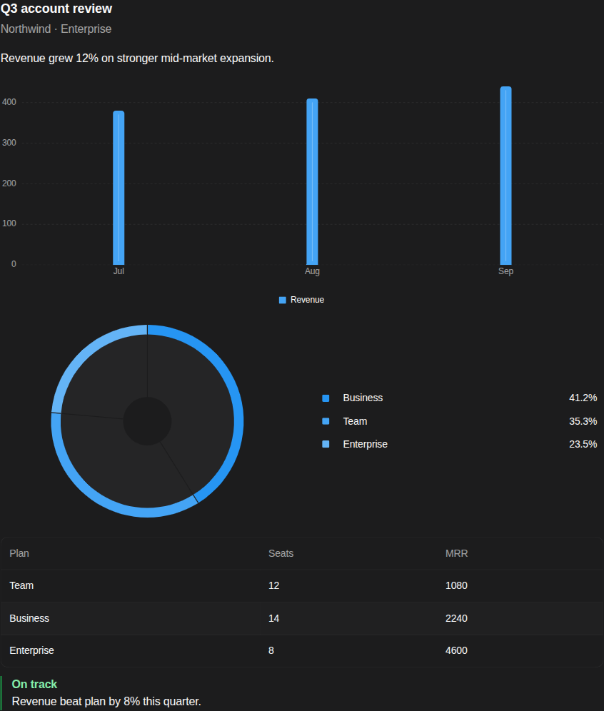
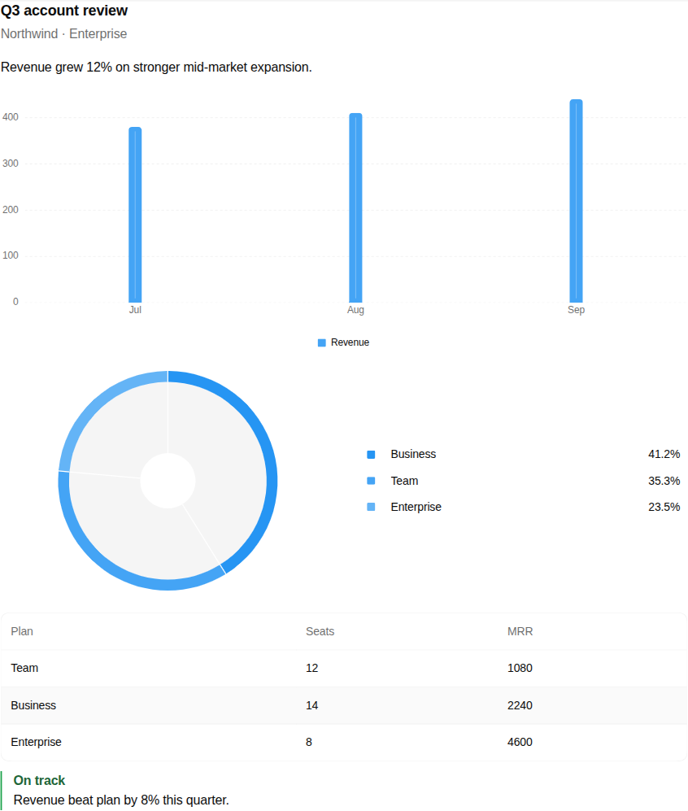

# OpenUI widgets for DeepSeek Harness

The agent answers with a real UI instead of prose. It writes an OpenUI Lang program, the Harness validates it, and the chat transcript draws it with the full [`@openuidev/react-ui`](https://www.npmjs.com/package/@openuidev/react-ui) library: 85 components including bar, line, area, pie, radar, and scatter charts, tables, cards, callouts, icons, and forms.





## Install

The npm package name is `dsh-openui-widget`. Add it to the current DSH profile with the plugin manager, then reload the window.

```bash
dsh plugin --profile web add dsh-openui-widget
```

For a local checkout, link this folder into the `web` profile as `dsh-openui-widget` and reload.

## How it works

The plugin adds two tools and one transcript view.

| Piece | Wire name | What it does |
|---|---|---|
| Guide tool | `openui_catalog` | Returns OpenUI's own generated prompt: syntax, rules, every component signature, and worked examples |
| Render tool | `openui_render` | Validates an OpenUI Lang program and commits it as a tool result |
| Chat view | slot key `openui_render` | Draws the program with OpenUI's renderer and its stylesheet |

The vocabulary is large, about 52 KiB, so it is a tool the agent calls once rather than text attached to every request. In practice a conversation costs one guide read, then one render call per widget.

A program is a few lines and always starts at the library's root component:

```
root = Card([header, summary, chart, table, note])
header = CardHeader("Q3 account review", "Northwind · Enterprise")
summary = TextContent("Revenue grew 12% on stronger mid-market expansion.")
chart = BarChart(["Jul", "Aug", "Sep"], [revenue])
revenue = Series("Revenue", [380, 410, 440])
table = Table([planCol, seatCol])
planCol = Col("Plan", ["Team", "Business", "Enterprise"])
seatCol = Col("Seats", [12, 14, 8], "number")
note = Callout("success", "On track", "Revenue beat plan by 8% this quarter.", true)
```

## What you get

- **The real library.** Not a lookalike. Components, charts, and layout come from `@openuidev/react-ui@0.18.6`, with its stylesheet bundled into the client artifact.
- **Validation before commit.** The host parses every program against the same schema the client draws with, so a broken program comes back to the agent as an error naming the component, the missing argument, or the unknown name. It fixes it and calls again instead of showing an empty card.
- **Durable widgets.** The program is stored in the tool result's `meta`, so reopening a session redraws the widget from the log with no regeneration.
- **No hosted services.** No OpenUI Gateway, no Autofix API, no API key, and no network call from either half.

## Requirements

- DeepSeek Harness with the Web UI. The view claims the `tool.call.toolview` slot.
- Node.js 20 or later to build from source.

## Limitations

- **Weight.** The client artifact inlines the whole library, about 3.4 MB raw and 890 KiB gzipped. It is fetched lazily and cached by revision, so it costs one download per version, not one per widget.
- **Theme.** OpenUI themes itself from `prefers-color-scheme`, not from the Harness appearance setting. A dark Harness on a light OS shows a light widget.
- **Display only.** Forms and buttons render but their actions are not routed back to the agent. A widget cannot send a message or call a tool.
- **No streaming.** The widget appears when the tool call settles, not token by token.
- **History.** In deep history where the paired tool call has scrolled out of the loaded window, the transcript falls back to the generic tool card.

## Development

```bash
npm install
npm test           # capture library data, compile both halves, typecheck, run the tests
npm run typecheck  # typecheck only
npm run bundle     # capture and compile, without tests
```

The sources are TypeScript and only two files ship compiled: `lib/host.js` for the Harness host and `lib/client.js` for the browser. `library.generated.ts` is written from the installed OpenUI library by `build.ts`; never edit it by hand.

## License

MIT
